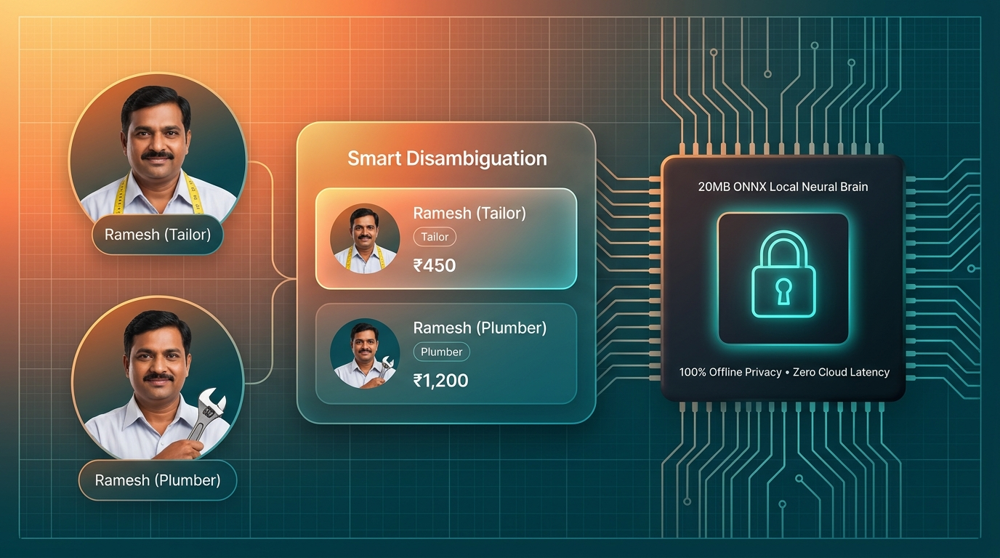
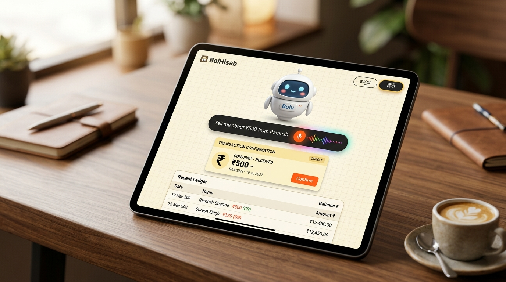

<div align="center">

# BolHisab (बोलहिसाब)

### *“Boliye. Hisaab ho gaya.”*

**A voice-first daily khata ledger for chaiwalas, small shops, and neighborhood vendors.**

[](https://github.com/rshamith777-cpu/bolhisab)
[](https://github.com/rshamith777-cpu/bolhisab)
[](https://github.com/rshamith777-cpu/bolhisab)
[](https://github.com/rshamith777-cpu/bolhisab)
[](https://github.com/rshamith777-cpu/bolhisab)

<br/>


</div>

---

## 📖 Table of Contents
1. [The Real-World Problem](#-the-real-world-problem)
2. [What is BolHisab?](#-what-is-bolhisab)
3. [Key Innovations](#-key-innovations)
   - [Interactive 3D Ceramic Assistant ("Bolu")](#1-interactive-3d-ceramic-assistant-bolu)
   - [The "Two Rameshes" Disambiguation Problem](#2-the-two-rameshes-disambiguation-engine)
   - [20MB In-Browser Local Neural AI Brain](#3-20mb-in-browser-local-neural-ai-brain-onnx)
   - [Grammatical Case Suffix Stripper & Pure Regional Voice](#4-indic-grammatical-suffix-stripping--pure-regional-voice)
4. [Website UI Showcase](#-website-ui-showcase)
5. [Multi-Lingual Voice Commands (10 Languages)](#-supported-commands-10-indian-regional-languages)
6. [Strict Financial Safety Principles](#-strict-financial-safety-principles)
7. [Architecture & Zero-Data-Leak Privacy](#-architecture--privacy-guarantee)
8. [Quick Start (Localhost Running)](#-quick-start)
9. [Automated Verification Suite](#-automated-testing--verification-suite)
10. [Repository Structure](#-repository-structure)
11. [License](#-license)

---

## ☕ The Real-World Problem

In every Indian neighborhood (*mohalla*), roadside tea vendors (*chaiwalas*), kirana shops, and daily wage businesses operate amidst intense morning rushes:
- **Dirty & Busy Hands:** One hand strains tea leaves, the other boils milk, while 4 customers order at once. Shopkeepers cannot unlock oily phones or navigate complicated multi-screen apps.
- **Lost Paper Notebooks:** Traditional physical *khata* notebooks get stained with tea, torn, or misplaced, leading to unresolved debts and lost income.
- **Cluttered Fintech Apps:** Mainstream apps are bloated with loans, investments, ads, and crypto clutter, demanding heavy internet connectivity and English fluency.
- **The Duplicate Name Dilemma:** Real neighborhoods have multiple customers with the same common name (*Ramesh the Tailor* vs. *Ramesh the Plumber*). A naive voice system merges their debts and ruins community trust.

---

## 💡 What is BolHisab?

**BolHisab (“Boliye. Hisaab ho gaya.”)** is an offline-first, voice-native daily ledger designed specifically for Indian micro-merchants:
1. **Speak Naturally:** Speak or type in everyday **Hindi, Kannada, Tamil, Telugu, Malayalam, Marathi, Bengali, Gujarati, Punjabi, or Indian English**.
2. **Safe Confirmation Preview:** Voice inputs **never** alter the ledger automatically. A structured preview card shows previous balance, the transaction, and the resulting balance. It commits **only** when confirmed.
3. **100% Client-Side Privacy:** All customer debts and phone numbers live exclusively in your device's browser **IndexedDB**—never sent to any cloud server.

---

## 🌟 Key Innovations

### 1. Interactive 3D Ceramic Assistant ("Bolu")
- Built with **pure Three.js (0.160.0)** without external 3D engine wrappers or bundlers.
- **Tactile Materiality:** Designed with warm artisan stoneware ceramic (`#988775`) contrasted against crisp white porcelain armor plates (`#ffffff`).
- **Cursor Parallax & Responsive Gaze:** Bolu watches your cursor and reacts with blinking expressions and state changes (from an active assistant to a glowing trust shield).
- **Reduced Motion & Canvas Fallback:** Automatically adapts to user preferences and low-end hardware with zero layout shift.

---

### 2. The "Two Rameshes" Disambiguation Engine

<div align="center">
  
</div>

In Indian mohallas, every neighborhood has multiple people with identical first names:
- **Zero Hallucinated Debt:** When the shopkeeper asks *"Ramesh ka balance batao"* or *"Ramesh ko 40 rupaye udhaar likho"*, BolHisab identifies duplicate matches and opens an interactive **Disambiguation Card** showing:
  - Full Name & **Profession / Nickname tag** (*Tailor*, *Plumber*)
  - **Area / Mohalla** (*Main Bazar*, *Station Road*)
  - Phone snippet and outstanding balance
- **Regional Spoken Prompt:** Bolu announces aloud in the selected language:
  - *Hindi:* `"2 Ramesh mile: Ramesh (Tailor) ya Ramesh (Plumber)? Kise chunna hai?"`
  - *Kannada:* `"2 ರಮೇಶ್ ಸಿಕ್ಕಿದ್ದಾರೆ: Ramesh (Tailor) ಅಥವಾ Ramesh (Plumber)? ಯಾರನ್ನು ಆಯ್ಕೆ ಮಾಡುತ್ತೀರಿ?"`
- **Smart Mention Bypass:** If the shopkeeper explicitly says *"Ramesh Tailor ko 40 rupaye udhaar likho"*, the system detects the nickname tag and resolves directly without prompting.

---

### 3. 20MB In-Browser Local Neural AI Brain (ONNX)
- **Local Neural Embeddings:** Dynamically connects to `@xenova/transformers` running the quantized **`all-MiniLM-L6-v2`** model (~23MB) directly inside browser WebAssembly.
- **Zero Cloud Leaks:** Complete natural language understanding happens inside client-side RAM. Financial data never touches an external API.
- **Instant Micro-Vector Fallback (0 KB):** If offline or before the model downloads, BolHisab seamlessly runs on its built-in sub-millisecond local semantic vector matcher (< 2ms response time).
- **Console Badge Indicator:** Shows real-time brain status (`LOCAL AI: 20MB NEURAL ONNX` or `LOCAL AI: SEMANTIC VECTOR (OFFLINE)`).

---

### 4. Indic Grammatical Suffix Stripping & Pure Regional Voice
- **Suffix Normalization:** In Indian languages, case prepositions attach directly to names:
  - Kannada: `ರಮೇಶ್ಗೆ` / `Ramesh-ge` (to Ramesh) $\to$ normalized to `ರಮೇಶ್`
  - Tamil: `ரமேஷுக்கு` (`Ramesh-ukku`) $\to$ normalized to `ரமேஷ்`
  - Telugu: `రమేష్ కు` (`Ramesh-ku`) $\to$ normalized to `రమేష్`
  - Marathi: `रमेशला` (`Ramesh-la`) $\to$ normalized to `रमेश`
  - Bengali: `রমেশকে` (`Ramesh-ke`) $\to$ normalized to `রমেশ`
- **Native Numeral Converter:** Automatically converts all Indic numerals (Devanagari `०-९`, Bengali `০-৯`, Gujarati `૦-૯`, Gurmukhi `੦-੯`, Tamil `௦-௯`, Telugu `౦-౯`, Kannada `೦-೯`, Malayalam `൦-൯`) to standard digits.
- **Zero Hindi Slang in Regional Talk-Back:** When Kannada is selected, BolHisab responds in **pure Kannada speech** (*"ರಮೇಶ್ ಬಾಕಿ 160 ರೂಪಾಯಿ."*) rather than mixing Hindi slang like *"ka baki"* or *"grahak"*.

---

## 🖥️ Website UI Showcase

<div align="center">
  
</div>

- **Paper-Grid Background:** Tactile warm parchment texture (`#ece8e1`) with hairline vertical guide markers (17%, 50%, 83%).
- **Interactive Action Tabs:** One-tap switching between Udhaar (Credit), Jama (Payment), Balance, Inventory Restock, and Daily Summary.
- **Instant Customer Drawer:** Displays customer phone, area, total debt, and single-click **WhatsApp Payment Reminder** copy tool.

---

## 🎙️ Supported Commands (10 Indian Regional Languages)

BolHisab supports **10 Indian regional languages** in both native scripts and Roman transliterations:

| # | Language & Locale | Sample Voice Command | Action / Intent | Resulting Behavior |
|---|---|---|---|---|
| 1 | **हिन्दी** (`hi-IN`) | *"Ramesh ko 40 rupaye udhaar likho."* | `ADD_CREDIT` | Previews ₹40 credit for Ramesh; requires confirmation tap to commit. |
| 2 | **English** (`en-IN`) | *"Ramesh paid 50 rupees."* | `RECORD_PAYMENT` | Previews ₹50 cash payment; verifies payment doesn't exceed balance. |
| 3 | **ಕನ್ನಡ** (`kn-IN`) | *"ರಮೇಶ್ಗೆ ಎಷ್ಟು"* / *"ramesh ge estu"* | `GET_BALANCE` | Strips suffix `-ಗೆ` and reads aloud current outstanding balance. |
| 4 | **தமிழ்** (`ta-IN`) | *"ரமேஷுக்கு 40 ரூபாய் கடன் எழுது"* | `ADD_CREDIT` | Strips `-க்கு` suffix and opens safe confirmation preview card. |
| 5 | **తెలుగు** (`te-IN`) | *"ఈ రోజు లెక్క చూపించు"* | `DAILY_SUMMARY` | Calculates today's total credit extended, cash collected, and count. |
| 6 | **മലയാളം** (`ml-IN`) | *"രമേഷിന് 40 രൂപ കടം എഴുതുക"* | `ADD_CREDIT` | Strips `-ന്` suffix and queues ₹40 credit preview. |
| 7 | **मराठी** (`mr-IN`) | *"रमेशने 50 रुपये दिले"* | `RECORD_PAYMENT` | Records ₹50 payment received with Marathi voice confirmation. |
| 8 | **বাংলা** (`bn-IN`) | *"রমেশকে ৪০ টাকা ধার লিখুন"* | `ADD_CREDIT` | Normalizes Bengali digits `৪০` $\to$ 40 and prepares confirmation. |
| 9 | **ગુજરાતી** (`gu-IN`) | *"દૂધ 20 પેકેટ સ્ટોકમાં ઉમેરો"* | `RESTOCK_ITEM` | Restocks 20 packets of milk into local inventory. |
| 10 | **ਪੰਜਾਬੀ** (`pa-IN`) | *"ਰਮੇਸ਼ ਨੇ 50 ਰੁਪਏ ਦੇ ਦਿੱਤੇ"* | `RECORD_PAYMENT` | Records ₹50 payment for Ramesh. |

---

## 🛡️ Strict Financial Safety Principles

```
                  ┌──────────────────────────────┐
                  │ Spoken Command / Text Input  │
                  └──────────────┬───────────────┘
                                 │
                                 ▼
                  ┌──────────────────────────────┐
                  │ Local Multi-Lingual Parser   │
                  │ (NLP + 20MB In-Browser Brain)│
                  └──────────────┬───────────────┘
                                 │
                                 ▼
                  ┌──────────────────────────────┐
                  │ Safe Confirmation Card       │  ◄── User MUST tap
                  │ (Preview Old + Change = New) │      "Haan, Save Karein"
                  └──────────────┬───────────────┘
                                 │
                                 ▼
                  ┌──────────────────────────────┐
                  │ Local IndexedDB Ledger       │
                  │ (Stored in Integer Paise)    │
                  └──────────────────────────────┘
```

1. **Confirm Before Save (Never Auto-Commit):**  
   Spoken words or transcripts **never** alter the financial ledger directly. Every write action displays a structured preview card showing customer name, prior balance, amount, and projected balance. The ledger updates **only** when the user taps **"Haan, save karein"**.
2. **Mathematical Integrity in Integer Paise:**  
   Financial amounts are calculated in integer paise (`Math.round(rupees * 100)`), avoiding JavaScript floating-point errors (`0.1 + 0.2 !== 0.3`).
3. **Zero Negative Debt Anomalies:**  
   Payments cannot exceed outstanding dues. If Ramesh owes ₹160 and pays ₹500, the system blocks the transaction with an alert.
4. **Instant Auditable Undo:**  
   An immediate Undo toast appears upon saving, allowing the shopkeeper to reverse any mistaken entry with a single tap.
5. **No Hallucinated Financials:**  
   Balances are never generated by an LLM; they are mathematically summed from validated local ledger entries.

---

## 🏗️ Architecture & Privacy Guarantee

```
┌────────────────────────────────────────────────────────┐
│                      BolHisab UI                       │
│  (Single index.html · Three.js 0.160.0 · IndexedDB)    │
└──────────────────────────┬─────────────────────────────┘
                           │
             ┌─────────────┴─────────────┐
             ▼                           ▼
 ┌──────────────────────┐    ┌────────────────────────┐
 │ 20MB Local AI Brain  │    │ Optional server.mjs    │
 │ (@xenova/transformers│    │ (Node built-in HTTP)   │
 │  In-Browser ONNX)    │    └───────────┬────────────┘
 └──────────────────────┘                │ Only raw command text
                                         ▼ (Never ledger data!)
                             ┌────────────────────────┐
                             │ Optional Cloud LLM     │
                             │ (Gemini / OpenAI API)  │
                             └────────────────────────┘
```

- **Local Parser & Neural Brain (Default):** Runs 100% in the browser. Zero customer phone numbers, balances, or debts are ever transmitted over the network.
- **Optional Hybrid Cloud AI:** If `server.mjs` is run with `GEMINI_API_KEY` or `OPENAI_API_KEY`, the server exposes `POST /api/ai/parse` solely for intent extraction on unrecognized slang.

---

## ⚡ Quick Start

### Option A: Direct Static (No server required)
Simply double-click or open `index.html` in Google Chrome, Microsoft Edge, Safari, or Firefox.  
BolHisab runs **100% offline** using its built-in local multi-lingual parser, in-browser neural AI brain, and browser IndexedDB.

### Option B: Local Node.js Server (Recommended for Voice & Audio)
Web Speech API (`webkitSpeechRecognition`) works best when served over `http://localhost`.

Run with Node.js (v18+ with zero external npm dependencies):
```bash
node server.mjs
```
Then open: **[http://localhost:3000](http://localhost:3000)** in your browser.

---

## 🧪 Automated Testing & Verification Suite

BolHisab includes comprehensive test suites covering all languages, suffix rules, and server endpoints:

```bash
# 1. Run Master Suite (All 10 Languages & Voice Synthesis)
node tests/test-all-languages-and-voice.mjs

# 2. Run Disambiguation Suite ("Two Rameshes" duplicate problem)
node tests/test-disambiguation.mjs

# 3. Run Regional Parser Suite (Indic suffix stripping)
node tests/test-regional-parser.mjs

# 4. Run Live Localhost Server Suite
node tests/test-localhost-server.mjs

# 5. Run HTML Structure & Three.js Canvas Validation
node tests/test-html.mjs
```

**Results:** **52 / 52 Tests Passing (100% Green)**.

---

## 📁 Repository Structure

```text
BOLHISAB/
├── .gitignore                          # Clean ignore rules
├── index.html                          # Complete frontend (HTML, CSS, Vanilla JS, Three.js 0.160.0)
├── server.mjs                          # Zero-dependency Node.js static server & optional AI bridge
├── README.md                           # Documentation, architecture, and feature guides
├── assets/                             # Visual media and graphics
│   ├── bolhisab-hero-banner.jpg        # Cinematic chai stall & ceramic assistant banner
│   ├── bolhisab-ui-showcase.jpg        # Isometric 3D UI product mockup
│   └── bolhisab-disambiguation-ai.jpg  # Infographic for Two Rameshes & 20MB Local AI Brain
├── docs/
│   ├── demo-script.md                  # 2–3 minute hackathon presentation demo script
│   ├── pitch-deck-outline.md           # 7-slide presentation pitch deck outline
│   └── local-ai-brain-and-disambiguation-plan.md # Architectural specification
└── tests/
    ├── test-all-languages-and-voice.mjs # 39 tests across 10 Indic languages & voice hooks
    ├── test-disambiguation.mjs         # 9 tests for duplicate customer resolution
    ├── test-regional-parser.mjs        # 13 tests for Indic case suffix stripping
    ├── test-localhost-server.mjs       # Live HTTP localhost server integration test
    ├── test-html.mjs                   # 12 HTML & Three.js canvas structure tests
    └── test-parser.mjs                 # 8 base financial parser tests
```

---

## 📜 License
Built with ❤️ for **VibeX Codes Track 1** (2026). Dedicated to the daily workers, chaiwalas, and small business owners of India.
